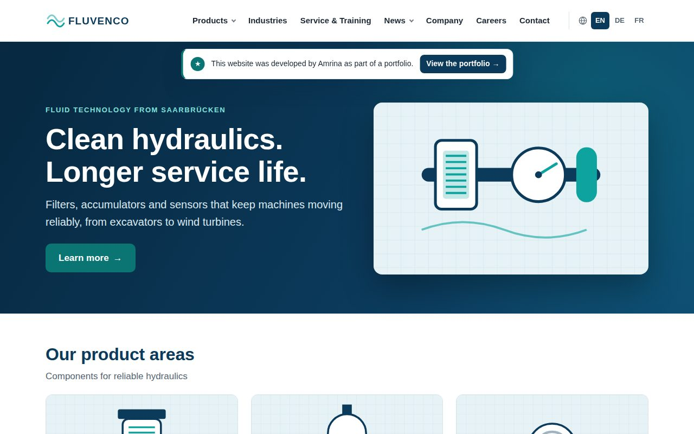

# Fluvenco: multilingual corporate website with TYPO3 13 LTS

**Project 2026** · [Website](https://sayamrina.github.io/fluvenco-typo3/site/en/) · [Project page](https://sayamrina.github.io/fluvenco-typo3/) · [Portfolio](https://sayamrina.github.io/)

A website for **Fluvenco Fluidtechnik**, a fictional manufacturer of hydraulic filters, accumulators and sensors, in English, German and French. Besides the site itself, the project covers the work around it: an editor guide, a translation and approval process for country websites, SEO and automated quality assurance.



## Kurzbeschreibung (Deutsch)

Mehrsprachige Unternehmenswebsite (EN, DE, FR) mit TYPO3 13 LTS: eigenes Sitepackage mit Fluid-Templates und Site Sets, zwei eigene Inhaltselemente, verbundene Übersetzungen, Benutzergruppen für Länderredaktionen, Redakteursleitfaden, Übersetzungsworkflow und automatische QA (Links, SEO, Barrierefreiheit). Dokumentation auf Deutsch im Ordner [`guides/`](guides/).

## What is in it

| Area | Details |
|---|---|
| TYPO3 setup | TYPO3 13.4 LTS (Composer), SQLite, sitepackage `fluvenco_sitepackage` with a site set, PAGEVIEW + Fluid templates, TypoScript, page TSconfig |
| Content elements | `fluvenco_hero` (stage with image and call to action), `fluvenco_cards` (subpages as teaser cards), plus restricted core elements (text, text & media, bullets, table) |
| Languages | English (default), German, French; connected translation mode, strict fallback, localized URL segments, translated UI labels (XLIFF) and image alt texts |
| SEO | page titles and descriptions per language, canonical, `hreflang` + `x-default`, XML sitemap, readable URLs |
| Editors | backend layout with one main column, limited content element wizard, groups for central editors and DE/FR translators with language restrictions |
| Quality assurance | `site/Build/qa/qa.py` crawls all pages in all languages with Playwright and checks HTTP status, links, title, description, one h1, alt texts, hreflang and WCAG 2.1 AA via axe-core. Last run: 45 pages, 0 issues ([report](guides/QA-Bericht.md)) |
| Delivery | `site/Build/export.py` exports the site as static HTML for GitHub Pages |

## Documentation (German)

- [Redakteursleitfaden](guides/Redakteursleitfaden.md): editing content, pages, images, SEO fields, approval, roles
- [Übersetzung und Launch einer Länderwebsite](guides/Uebersetzung-und-Freigabe.md): process, glossary, go-live checklist
- [QA-Checkliste](guides/QA-Checkliste.md) and [QA-Bericht](guides/QA-Bericht.md)

## Run it locally

Requirements: PHP 8.2+ with `pdo_sqlite`, `intl`, `gd`, `mbstring`, `xml`, `zip`; Composer.

```bash
cd site
composer install
export TYPO3_ADMIN_USER=admin TYPO3_ADMIN_PASSWORD='choose-a-strong-password'
Build/reset.sh                     # fresh database, page tree, content, translations, editor groups
TYPO3_CONTEXT=Development php -S 127.0.0.1:8080 -t public Build/router.php
```

Open <http://127.0.0.1:8080/en/> for the site and <http://127.0.0.1:8080/typo3/> for the backend.

The page tree and all content are created by the console command `fluvenco:seed` ([`SeedCommand.php`](site/packages/fluvenco_sitepackage/Classes/Command/SeedCommand.php)) through TYPO3's DataHandler, the same API the backend uses. The content itself lives in [`content.json`](site/packages/fluvenco_sitepackage/Resources/Private/Seed/content.json).

## Structure

```
site/                         TYPO3 project
  config/sites/fluvenco/      site configuration (languages, URLs, sitemap route)
  packages/fluvenco_sitepackage/
    Configuration/Sets/Site/  TypoScript, page TSconfig, settings
    Configuration/TCA/        custom content elements
    Resources/Private/        Fluid templates, XLIFF labels, seed content
    Resources/Public/         CSS, JS, logo
  Build/                      reset, QA and export scripts
guides/                       editor guide, translation workflow, QA (German)
docs/                         GitHub Pages: project page and static export of the site
```

## Notes

Fluvenco is a fictional company; all names, figures and addresses are invented. This website was built by Amrina, with AI as a supporting tool for coding.
